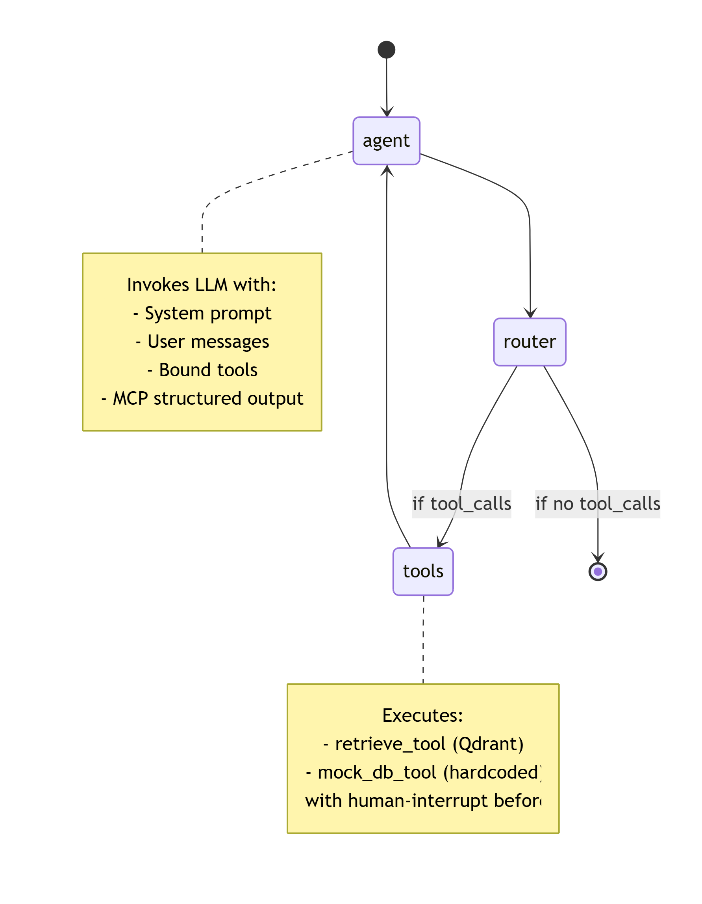
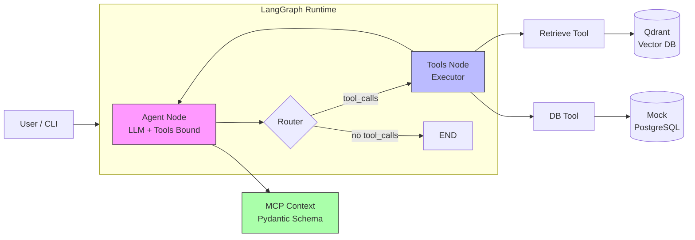
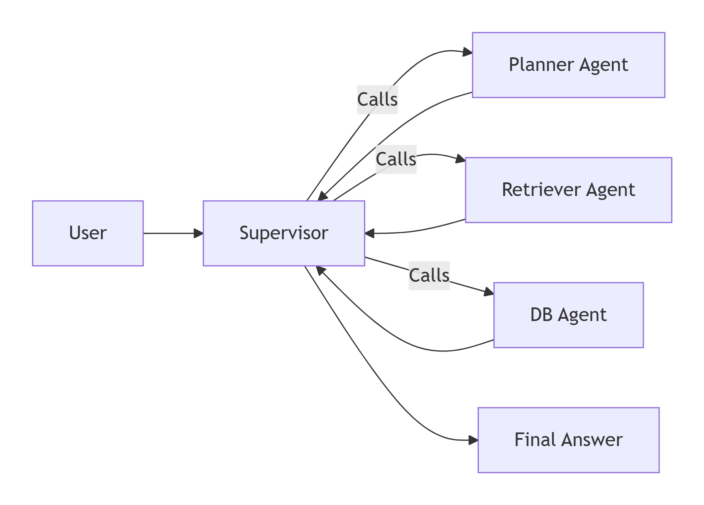

# 🧠 Agentic AI Hackathon

##🧠 Sprint 1: Single-Agent RAG with MCP & Qdrant 
> *LangGraph · Qdrant · MCP · Human-in-the-Loop · Observability*

##🧠 Sprint 2: Multi-Agent Supervisor with Routing & Delegation
> *LangGraph · Supervisor Pattern · Specialized Agents · Planner · Hand-off Loops*

##🧠 Sprint 3: Production API with FastAPI, Docker & RAGAS
> *FastAPI · Docker · RAGAS · CI/CD Ready · Production Deployment*
---

## 📌 Overview

This is **Day 1** of a 3‑Sprint accelerated programme to master production‑grade agentic AI.  
The agent answers regulatory and customer‑context queries by:

1. **Retrieving** policies from a Qdrant vector store (RAG).
2. **Querying** a mock banking system (tool call).
3. **Enforcing** an MCP (Model Context Protocol) structured schema before acting.
4. **Pausing** for human confirmation before sensitive DB lookups.

---
This is **Day 2** of a 3‑Sprint accelerated programme to master production‑grade agentic AI.  
The system evolves from a single agent into a **multi-agent supervisor architecture** that delegates tasks to specialized workers by:

1. **Supervising** the user query with a central routing agent that decides which specialist to call.
2. **Delegating** to three specialized workers: a Retriever Agent (RAG expert), a DB Agent (banking data expert), and a Planner Agent (complex reasoning expert).
3. **Handling multi‑step queries** by routing first to the Planner Agent, which breaks down the request into a step‑by‑step plan before invoking the Retriever or DB agents.
4. **Maintaining coordination** through a hand‑off loop where each worker returns control to the Supervisor to decide the next action or finish.
---
This is **Day 3** of a 3‑Sprint accelerated programme to master production‑grade agentic AI.  
The system is packaged as a production‑ready service with enterprise‑grade deployment and evaluation capabilities by:

1. **Exposing** the multi-agent system through a FastAPI REST API with `/ask` and `/health` endpoints for real‑time inference.
2. **Containerizing** the entire application with Docker and Docker Compose, ensuring consistent deployment across any environment.
3. **Evaluating** retrieval quality using RAGAS metrics (Faithfulness, Answer Relevancy, Context Recall) to measure system performance quantitatively.
4. **Enabling** seamless integration into CI/CD pipelines and cloud platforms, bridging the gap between prototype and production.
---

## 🏗️ System Architecture

### High‑Level Component View




---

## 1. Clone & Environment
``` bash
git clone https://github.com/dotteduniverse/agentic_hackathon.git
cd agentic_hackathon
python -m venv venv
source venv/bin/activate      # Windows: venv\Scripts\activate
pip install -r requirements.txt
```
---

## 2. Configure Secrets

Copy .env.example to .env and fill:
``` bash
env
# Choose ONE LLM backend
GROQ_API_KEY=your_key_here       # if using Groq (free, fast)
# OLLAMA_BASE_URL=http://localhost:11434  # if using local

QDRANT_PATH=./qdrant_db          # local disk path
# QDRANT_URL=...                 # uncomment if using cloud
# QDRANT_API_KEY=...
```
---

## 3. Ingest Regulatory PDFs
Place your 3 PDFs (GDPR/BCBS/SOC2 snippets) into ./docs/, then run:

``` bash
python -m src.qdrant_ingest
Expected output: ✅ Ingested 47 chunks into collection 'regulatory_docs'.
```
---
## 4. Run the Agent
bash
python demo.py
```text
Example query:

text
> What does GDPR say about data retention, and does customer A-123 have pending transactions?
You will see:

MCP context being constructed

Tool calls with interrupt confirmation

Final structured answer
```
---

## 🧪 Testing
```bash
pytest tests/test_graph.py -v
Contains 3 golden queries covering:

Pure retrieval

Pure DB lookup

Hybrid (both)
```
---

## 📊 Observability Example (Logs)
Each run writes to logs/ with:

``` text
timestamp: 2025-06-27T10:00:00
query: GDPR retention for customer A-123
tools_called: retrieve_tool, mock_db_tool
tokens: 1245 (in) / 678 (out)
latency_ms: 342
mcp_context: {"intent": "compliance_check", "balance": 4500.0}
final_answer: Under Article 5, retention must be minimised...
```
---
# Sprint 2: Multi-Agent Supervisor
A supervisor delegates tasks to three specialized workers: Retriever Agent (RAG), DB Agent (data), and Planner Agent (reasoning). Complex queries are routed to the Planner first.
### Sprint 2: Multi-Agent Supervisor

**Goal:** Replace the single agent with a Supervisor that delegates tasks to specialized workers.

**Architecture:**



---
# Sprint 3: Production API + Evaluation

- **FastAPI** wraps the multi-agent system with `/ask` and `/health` endpoints.
- **Docker** containerizes the service.
- **RAGAS** provides evaluation metrics (Faithfulness, Context Recall, Answer Relevancy).

---

## 🚀 Features

| Capability | Sprint | Implementation |
| :--- | :--- | :--- |
| **LangGraph orchestration** | 1 | StateGraph with conditional routing |
| **Qdrant vector DB** | 1 | Local disk storage, `all-MiniLM-L6-v2` |
| **MCP context schema** | 1 | Pydantic model enforced via `with_structured_output` |
| **Human‑in‑the‑loop** | 1 | Interrupt before DB tool execution |
| **Multi-Agent Supervisor** | 2 | Supervisor delegates to 3 specialized agents |
| **Planner Agent** | 2 | Breaks down complex multi-step queries |
| **FastAPI REST API** | 3 | `/ask` and `/health` endpoints |
| **Docker containerization** | 3 | Production-ready deployment |
| **RAGAS evaluation** | 3 | Faithfulness, Answer Relevancy, Context Recall |

---

## 📁 Project Structure

```text
agentic_hackathon/
├── README.md                    # You are here
├── requirements.txt
├── Dockerfile
├── docker-compose.yml
├── .env.example
├── config.py
├── evaluate_ragas.py            # Sprint 3
├── demo.py                      # Sprint 1 (Single Agent)
├── demo_supervisor.py           # Sprint 2 (Multi-Agent)
├── src/
│   ├── __init__.py
│   ├── api.py                   # Sprint 3 (FastAPI)
│   ├── state.py                 # AgentState, MCPContext, SupervisorState
│   ├── prompts.py
│   ├── qdrant_ingest.py
│   ├── graph.py                 # Sprint 1
│   ├── agents.py                # Sprint 2 (Retriever, DB, Planner)
│   ├── supervisor_graph.py      # Sprint 2
│   └── tools/
│       ├── retrieve.py
│       └── mock_db.py
├── docs/                        # Place PDFs here
├── logs/
└── qdrant_db/                   # Auto-generated, .gitignored
```
## ⚙️ Setup & Installation
```bash
python -m src.qdrant_ingest
Expected output: ✅ Ingested X chunks into 'regulatory_docs'.
```

▶️ Running the Demos
Sprint 1: Single Agent
```bash
python demo.py
```
Sprint 2: Multi-Agent Supervisor
```bash
python demo_supervisor.py
```
Sprint 3: FastAPI Server
```bash
uvicorn src.api:app --reload
```
Test the API with curl:

```bash
curl -X POST http://localhost:8000/ask \
  -H "Content-Type: application/json" \
  -d '{"query": "What does GDPR say about retention?"}'
```
🐳 Docker Deployment
```bash
docker build -t agentic-hackathon .
docker run -p 8000:8000 -e GROQ_API_KEY=$GROQ_API_KEY agentic-hackathon
```
Or use Docker Compose:

```bash
docker-compose up
```
📊 Evaluation (RAGAS)
Run the RAGAS evaluation script to measure retrieval quality:

```bash
python evaluate_ragas.py
Example output:
```
```text
RAGAS Evaluation Results:
{'faithfulness': 0.85, 'answer_relevancy': 0.78, 'context_recall': 0.92}
```
---
## 🔮 Sprints

| Sprint | Focus | Status |
| :--- | :--- | :--- |
| **1** | Single agent + Qdrant + MCP + HITL | ✅ Complete |
| **2** | Multi‑agent Supervisor (Planner/Retriever/DB) with routing | ✅ Complete |
| **3** | FastAPI + Docker + RAGAS evaluation | ✅ Complete |
---

## 🧑‍💻 Author  
**Veera Malla Reddy. V** – AI Solution Architect  
[LinkedIn](https://www.linkedin.com/in/veera-malla-reddy/) · [GitHub](https://github.com/dotteduniverse/)

Built as part of a 3‑day self‑hackathon to create agentic AI for enterprise production.
.
.
.
